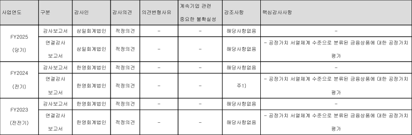

# 모델 학습 연결과 문서 추출 오류의 비교 검증

새로운 문서 입력을 처리한 뒤, 결과가 부족한 원인을 확인하기 위해 기존 코드의 학습 연결과 감사 공시의 추출 오류를 각각 검증했습니다. 모델 검증에서는 손실 함수만 바꿔 BERT에 학습 신호가 전달되는지 확인했습니다. 문서 검색에서는 모델과 질문을 고정하고, PDF 병합 셀에서 빠진 회계연도만 복원해 결과를 비교했습니다.

## 1. BERT 학습 신호 확인

현재 보관된 졸업연구 코드는 BERT 특징을 계산하지만, 학습 루프의 최종 손실은 캡션 손실입니다. 이 손실은 이미지 특징과 디코더 출력으로 계산되므로 BERT 출력까지 이어지는 경로가 없습니다.

이를 실행으로 확인하기 위해 원본 코드의 `TextDecoder`를 직접 불러왔습니다. 동일한 이미지 특징, 토큰과 초기 가중치를 사용하고, 캡션 손실만 계산하는 조건과 양방향 대조 손실을 추가하는 조건을 비교했습니다. 학습 경로를 확인하는 실험에는 무작위 입력과 32차원 소형 BERT를 사용했습니다. 따라서 아래 수치는 경로 연결을 검증한 결과이며 원래 모델의 성능 점수와는 측정 대상이 다릅니다.

| 확인 항목 | 캡션 손실만 사용 | 대조 손실 추가 |
| --- | ---: | ---: |
| 기울기가 생긴 BERT 파라미터 텐서 수 | 0 | 21 |
| BERT 전체 기울기의 L2 크기 | 0.000 | 59.004 |
| 한 번의 업데이트 후 BERT 가중치 변화의 L2 크기 | 0.000 | 0.059 |

기존 학습 경로에서는 BERT 가중치가 변하지 않았습니다. 대조 손실을 연결한 조건에서는 BERT까지 기울기가 전달되고 가중치가 바뀌었습니다. 이 코드 버전에는 이미지와 텍스트를 함께 학습하기 위한 연결 수정이 필요합니다. [원본 코드 사본](reference/graduatiothesisproject.py), [검증 결과](results/verification/gradient-check.json)

### 디코더의 미래 토큰 참조 확인

추가로 입력의 마지막 토큰만 바꾼 뒤 첫 위치의 예측값이 달라지는지 확인했습니다. 원본 클래스와 수정 클래스를 32차원 소형 구성으로 만들고, 두 디코더를 평가 모드로 실행해 드롭아웃 영향을 제거했습니다.

원본 디코더에서는 첫 위치 예측값의 최대 변화가 **0.0947**이었습니다. 미래 토큰을 가리는 마스크를 적용한 수정 디코더에서는 변화가 **0**이었습니다. 수정 디코더의 출력 어휘 수도 토크나이저와 동일한 **30,522개**로 확인했습니다. [검증 결과](results/verification/decoder-check.json)

## 2. 대조학습 연결 후 이미지·텍스트 검색 비교

학습 신호가 전달되는 것과 새 이미지에서 성능이 좋아지는 것은 각각 확인할 필요가 있습니다. 이를 위해 앞서 준비한 COCO-AB 표본 24개에서 ViT와 BERT의 사전학습 특징을 추출했습니다. 학습 16개, 검증 4개, 테스트 4개 분할을 그대로 사용했습니다.

두 인코더를 고정한 상태에서 768차원 텍스트 특징을 768차원 이미지 특징에 맞추는 선형 투영층만 학습했습니다. 비교 조건은 같은 초기 투영층을 업데이트하지 않은 상태와 양방향 대조 손실로 200회 업데이트한 상태입니다. 기존 캡션 손실은 이 투영층과 연결되지 않으므로 해당 층에는 업데이트를 제공하지 않습니다. 이 실험은 대조학습 연결 효과를 좁혀 확인하는 비교입니다. 캡션 생성 모델 전체의 재학습 결과는 별도입니다.

아래 값은 시드 42·43·44에서 얻은 Recall@1의 평균입니다. Recall@1은 후보 중 정답 쌍을 1위로 찾은 비율입니다.

| 평가 데이터 | 이미지→텍스트 · 연결 전 | 이미지→텍스트 · 대조학습 후 | 텍스트→이미지 · 연결 전 | 텍스트→이미지 · 대조학습 후 |
| --- | ---: | ---: | ---: | ---: |
| 학습 16개 | 0.063 | 1.000 | 0.042 | 1.000 |
| 검증 4개 | 0.167 | 0.083 | 0.250 | 0.083 |
| 테스트 4개 | 0.000 | 0.333 | 0.167 | 0.167 |

대조학습 후 학습용 16쌍은 모두 1위로 검색했습니다. 그러나 검증 성능은 낮아졌고, 테스트에서는 이미지→텍스트 방향만 개선됐습니다. 이는 학습 자료에 과적합했을 가능성을 보여줍니다. 수정한 연결이 학습에 작동한다는 점은 확인했지만, 이 표본에서 새 데이터에 대한 안정적인 개선을 확인하기는 어렵습니다.

검증과 테스트는 각각 4개이며, 후보가 4개일 때 무작위 선택의 기대 Recall@1은 0.25입니다. 세 시드에서도 같은 분할을 사용했습니다. 따라서 시드 평균은 서로 다른 테스트 자료로 세 번 검증한 결과와는 다릅니다. [시드별 순위와 학습 손실](results/verification/model-ablation.json)

## 3. 병합 셀의 회계연도 복원 전후 검색 비교

한국금융지주 공시의 `FY2025` 셀은 별도·연결 두 행에 걸쳐 있습니다. 원본 PDF의 셀 좌표를 확인해, 앞 행의 셀이 다음 행까지 실제로 이어지는 경우에만 회계연도를 복원했습니다. 이 방식으로 세로 병합 영역에 속한 셀만 처리했습니다.



예를 들어 연결감사 행의 텍스트는 다음과 같이 바뀌었습니다.

```text
복원 전  [빈 값] | 연결감사 보고서 | 삼일회계법인 | 적정의견 | …
복원 후  FY2025 (당기) | 연결감사 보고서 | 삼일회계법인 | 적정의견 | …
```

질문 8개, 정답 ID, 검색 모델, 메타데이터와 근거 59개의 ID를 고정했습니다. 회계연도가 빠진 10개 행의 첫 열만 바꿨습니다. 연도 이외의 열과 실제 빈 셀이 유지되는지도 검사했습니다.

### 한국금융지주 FY2025 연결 핵심감사사항의 정답 순위

| 검색 모델과 입력 | 복원 전 | 회계연도 복원 후 |
| --- | ---: | ---: |
| BM25 · 원문 | 20위 | 15위 |
| BM25 · 원문 + 기존 메타데이터 | 24위 | 13위 |
| E5 · 원문 | 21위 | 4위 |
| E5 · 원문 + 기존 메타데이터 | 17위 | 10위 |

같은 조건에서 회계연도를 복원하자 이 질문의 정답 순위가 개선됐습니다. 따라서 이 사례에서는 추출 과정에서 빠진 연도 정보가 검색 결과에 영향을 준다고 볼 수 있습니다. 다만 기존 메타데이터를 함께 쓴 E5 조건에서는 정답이 여전히 10위였습니다.

### 전체 질문 8개의 결과

| 모델과 입력 | Recall@5 · 복원 전 | Recall@5 · 복원 후 | MRR · 복원 전 | MRR · 복원 후 |
| --- | ---: | ---: | ---: | ---: |
| BM25 · 원문 | 0.500 | 0.500 | 0.253 | 0.260 |
| BM25 · 원문 + 기존 메타데이터 | 0.500 | 0.500 | 0.533 | 0.545 |
| E5 · 원문 | 0.750 | 0.750 | 0.668 | 0.690 |
| E5 · 원문 + 기존 메타데이터 | 0.750 | 0.750 | 0.557 | 0.624 |

전체 Recall@5는 같았습니다. 원문 E5에서 한국금융지주 질문은 상위 5개에 들어왔지만, CJ 별도 핵심감사사항 질문의 정답은 5위에서 6위로 내려갔습니다. 일부 질문의 개선이 전체 적중률 향상으로 이어지지는 않았습니다.

추가 확인으로 회계연도 외의 병합 셀도 복원했습니다. 이번 표본에서는 위 지표와 정답 순위가 같았습니다. 변경된 행의 원문, 모든 질문의 정답 순위와 상위 검색 결과는 JSON에 기록했습니다. [비교 결과](results/verification/audit-cell-ablation.json), [회계연도를 복원한 근거](results/verification/audit-evidence-restored.json)

## 4. 결과 해석

**기존 모델 코드에는 학습 연결 수정이 필요했습니다.** 캡션 손실만으로는 BERT 가중치가 바뀌지 않았고, 대조 손실을 추가하자 학습 신호가 전달됐습니다. 다만 학습용 쌍을 모두 맞힌 투영층도 작은 검증 자료에서는 성능이 떨어졌습니다. 연결 수정과 일반화 성능 확보는 각각 검증해야 합니다.

**문서 추출 방식도 검색 결과에 영향을 줬습니다.** 모델을 고정하고 빠진 회계연도를 복원하자 특정 질문의 정답 순위가 개선됐습니다. 전체 질문의 Recall@5는 같았으므로, 병합 셀 복원만으로 감사 공시 검색을 충분히 개선했다고 결론내리기는 어렵습니다.

이 결과는 학습 과정과 입력 처리 과정을 각각 확인해야 한다는 근거가 됩니다. 다음 비교에서는 더 많은 회사와 표를 대상으로 질문을 확장하고, 동일한 사실을 담은 정답 근거를 함께 표시할 수 있습니다. 이때 회계연도를 복원한 텍스트를 기준으로 삼으면, 원본 표 이미지가 추가로 도움이 되는 경우를 평가할 수 있습니다.

## 실험 재현 방법

프로젝트 의존성을 설치한 환경에서 다음 명령을 실행합니다. 원본 코드 사본과 COCO 표본은 프로젝트에 포함돼 있으며, 첫 실행에는 사전학습 모델 가중치 다운로드가 필요할 수 있습니다.

```bash
python verify_model_learning.py
python verify_audit_retrieval.py
```

검색 명령에서도 회계연도 복원 옵션을 사용할 수 있습니다.

```bash
python financial_retrieval.py --manifest data/external-audit.json --e5 --restore-period
```

코드는 `verify_model_learning.py`, `verify_audit_retrieval.py`, 결과는 `results/verification/`, 실행 로그는 `results/verify-model.log`, `results/verify-audit.log`에 있습니다.
